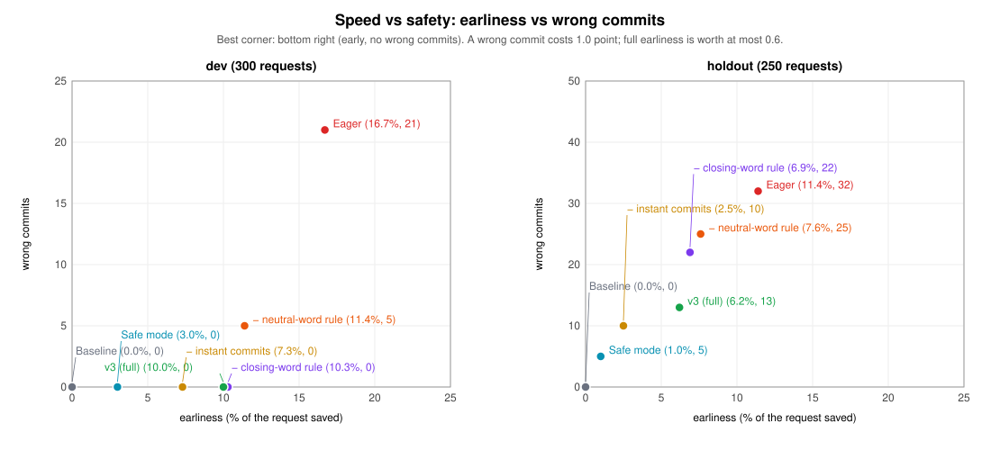

# Prescient

**"Your product, before your full stop."**
AgentX Challenge 1, Anticipatory Commerce (Techfest IIT Bombay 2026–27). Our agent is `agent.py`.
The organisers' original starter-kit instructions are in [`STARTER_KIT_README.md`](STARTER_KIT_README.md)
(`evaluate.py` says "see README.md": it means that file).

## Quick start (one command each)
Python 3 standard library only: nothing to install, no API key.

```bash
python3 evaluate.py --agent agent.py   # score Prescient on dev (add --log dev_results.jsonl to save the log)
python3 demo_app.py                    # live demo at http://127.0.0.1:8000
python3 compare.py                     # compare commit strategies → results/ablation.md, results/speed_safety.svg
```

## The problem, in one sentence
A shopper speaks a request one word at a time, and the agent must show the right product
**before they finish**, without ever showing a wrong one.

## The idea: "Prediction is not permission to act"
Prescient predicts the filters (category, colour, size, brand, max price) from every word.
But a prediction alone does not let it act. It shows a product only after the request has
settled. A wrong commit costs 1.0 point and earliness earns at most 0.6, so waiting is
always the safer mistake.

```
 word ──► ANTICIPATE ───────────────────► STABILIZE ─────────────────► COMMIT
          read the word, update filters,  still saying a value, or        one product left AND
          search once, narrow locally     about to correct it?             confidence ≥ 0.80
```

- **Anticipate.** Vocabularies turn words into filter values (English, Hindi and Hinglish
  words, prices like "dhai hazaar" or "0.8k"). A filter is **never tighter than what the
  shopper said**: a price applies only once its number is finished, and an unclear word
  stays a set ("shoes" = running shoes *or* sneakers). So if exactly one product still fits,
  it must be the target. One counted `tools.search` fetches the category (or brand), and
  every later word is filtered locally.
- **Stabilize.** Prescient waits while a correction word is open ("no", "sorry", "I mean",
  "galti se"), a number is still being spoken, a size or price phrase is open, or no
  **neutral word** has come since the last value. Lead-ins ("in", "by"), parts of a value
  ("rupees", "waist") and polite closers ("thanks", "please", "ji") do not count as neutral.
- **Commit.** Confidence = (1 ÷ products left) × (1 − chance a correction is still coming).
  It commits at ≥ 0.80. The correction chances were measured on dev by `tune.py`.

Details: [`docs/ARCHITECTURE.md`](docs/ARCHITECTURE.md) (one page) and [`docs/DETAILS.md`](docs/DETAILS.md). Live demo: `python3 demo_app.py`.

## Results (v4)

| Set | Requests | Status | Score | Accuracy | Wrong commits | Earliness (best possible) |
|---|---|---|---|---|---|---|
| **Dev**: Prescient | 300 | official set | **45.9** | 1.000 | 0 | 10.0 % (16.3 %) |
| Dev: organisers' baseline | 300 | official set | 20.0 | 0.527 | 0 | 0.0 % |
| Cross-validation (5-fold on dev) | 300 | settings picked on 4/5, scored on 1/5 | 45.9 ± 1.0 | — | 0 on every fold | — |
| Stress | 150 | ⚠ **used for fixes**, not independent | 44.0 | 1.000 | 0 | 6.6 % (11.3 %) |
| Blind | 100 | ⚠ **used for fixes**, not independent | 39.0 | 0.940 | 0 | 2.5 % (8.4 %) |
| **Holdout** | 250 | frozen, run once, never used for fixes | **37.6** (baseline 21.2) | 0.980 | 13 | 6.2 % (11.3 %) |

The holdout is our most honest estimate for new wording. Its failures are analysed in
[`results/holdout_report.md`](results/holdout_report.md). Searches per request: 1.03 on dev, 1.08 on holdout.



`results/speed_safety.svg`: earliness (x) against wrong commits (y), one point per strategy, for dev and holdout.

### Ablation: what each part is worth ([`results/ablation.md`](results/ablation.md))

| Strategy | Dev score | Dev wrong | Holdout score | Holdout wrong |
|---|---|---|---|---|
| Baseline (wait for full request) | 20.0 | 0 | 21.2 | 0 |
| Eager (no safety gate) | 43.0 | 21 | 33.1 | 32 |
| Prescient − neutral-word rule (naive 1-word delay) | 45.1 | 5 | 33.6 | 25 |
| Prescient − instant category/price commits | 44.4 | 0 | 36.5 | 10 |
| Prescient − closing-word rule | 46.1 | 0 | 34.4 | 22 |
| Prescient safe mode (no instant commits, 2 neutral words) | 41.7 | 0 | 37.6 | 5 |
| **Prescient v4 (full)** | **45.9** | **0** | **37.6** | **13** |

Every safety rule pays for itself on wording we never tuned on. The closing-word rule even
looks slightly harmful on dev, yet it prevents 9 wrong commits on the holdout.

## Stretch goals met
- **Hindi–English (Hinglish) requests.** Hindi colours ("kaala", "neela"), categories
  ("joote", "chappal", "ghadi"), prices ("dhai hazaar", "saadhe teen hazaar", "1000 se kam"),
  size words ("nau number") and correction cues ("galti se bola", "matlab"). Holdout
  `code_mixed`: 25 requests, accuracy 1.000, 0 wrong commits, earliness 11.8 %.
- **Tunable search limit** via `CONFIG["max_searches"]` (default 3, a hard cap per request).
  Measured by changing it in memory:

  | `max_searches` | Dev score / accuracy | Holdout score / accuracy | Most searches in one request |
  |---|---|---|---|
  | 1 | 44.7 / 0.973 | 34.7 / 0.908 | 1 |
  | 2 | 45.9 / 1.000 | 37.3 / 0.972 | 2 |
  | 3 (default) | 45.9 / 1.000 | 37.6 / 0.980 | 3 |

## Limitations
1. **Corrections after the request sounds finished.** If a shopper adds "…under ₹999 thanks,
   wait, I meant XL", Prescient may already have committed. This caused all 13 holdout wrong
   commits. The final answer was still right in every one, but each costs 1.0 point. Safe
   mode cuts them to 5, but costs 4.2 points on dev.
2. **Misspellings it has never seen** ("blie", "gey", "huodies", "white-ish"). Typo matching
   runs only at the end and is trusted only if it leaves exactly one product. It caused 5 of
   the 250 holdout answers to be wrong, and all 6 wrong blind answers.
3. **Hand-built vocabulary.** A new synonym has to be added by hand. The correction chances
   were measured on dev, which has only 55 requests with a correction.
4. **Catalogue size.** One search fetches up to `CONFIG["fetch_k"]` = 200 products. Today the
   largest pool is 174 (brand Urbanyx), so nothing is cut off. With a much bigger catalogue the
   pool would be cut off and "one product left" would no longer prove the target. A fetch-limit
   guard (v4) handles this: a full 200-product list is treated as possibly cut short, so the
   agent never commits early on it and ends with a normal filtered search (see `docs/FINALS_QA.md`).
5. **Earliness is about 60 % of the best possible** (10.0 % against 16.3 % on dev): this is
   the price of the safety rules.

## How to reproduce each number

| Number | Command |
|---|---|
| Dev score, accuracy, earliness, searches, latency, baseline | `python3 evaluate.py --agent agent.py` |
| Cross-validation 45.9 ± 1.0, correction-chance table | `python tune.py` (a few minutes) |
| Stress | `python3 evaluate.py --agent agent.py --data tests/stress.jsonl` |
| Blind | `python3 evaluate.py --agent agent.py --data tests/blind.jsonl` |
| Holdout (check it is unchanged first) | `python3 tests/make_holdout.py --check`, then `python3 evaluate.py --agent agent.py --data tests/holdout.jsonl` |
| Ablation table and speed–safety chart | `python3 compare.py` → `results/ablation.{md,csv}`, `results/speed_safety.svg` |
| Search-limit table | `python3 -c "import json,agent as A,evaluate as E; A.CONFIG['max_searches']=1; print(E.summarise(E.run(A.Agent,[json.loads(l) for l in open('dev.jsonl')])[0]))"` (change 1 to 2 or 3, and `dev.jsonl` to `tests/holdout.jsonl`) |

Latency was measured on a MacBook Air (M4, 16 GB), Python 3.14.6: about 0.05 ms per word
(p95 about 0.43 ms), timed around each `observe()` call, searches included.

## Files
`agent.py` (the agent; all settings in `CONFIG`) · `tune.py` · `compare.py` · `demo_app.py` ·
`docs/ARCHITECTURE.md` · `docs/DETAILS.md` · `docs/FINALS_QA.md` ·
`tests/` (stress, blind, frozen holdout and their generators) · `results/` · `dev_results.jsonl` (submitted dev log).

Organisers' starter kit (unchanged): `evaluate.py` · `search.py` · `catalogue.csv` · `dev.jsonl` ·
[`STARTER_KIT_README.md`](STARTER_KIT_README.md).
